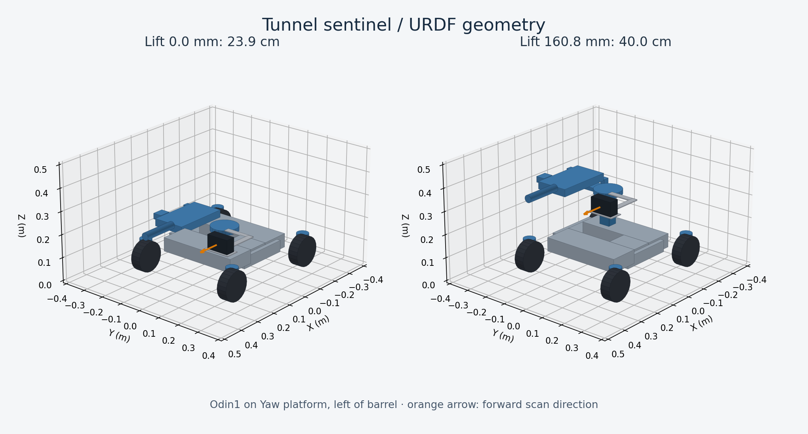

# 过洞哨兵：竖直滑台＋Yaw／Pitch

已加入独立竖直滑台，支持在电脑上运行 C++ 底盘、云台和升降控制。机械臂水平时，滑台最低的整车几何高度为 **23.925 cm**，升到最高为 **40 cm**，行程 **16.075 cm**。

原始 URDF 文件保持原样。扩展模型把原有 Yaw 的父连接接到滑台托架，沿用原有 Yaw／Pitch 偏移、轴向以及全部原有质量和惯量。扩展包含滑台、Odin1 固定支架和扫描坐标系，合计 17 个 link、16 个关节。详情见 [结构与尺寸](docs/compact_design.md)。

**Odin1 安装在炮口左侧，水平朝前，随 Yaw 转盘和滑台运动；枪管 Pitch 变化时，雷达相对转盘保持固定。** 安装位置和点云说明见 [odin1_mount.md](docs/odin1_mount.md)。



## 启动演示

```bash
cd /home/mul/Tunnel_sentry
make sim
```

在另一终端运行：

```bash
make -C /home/mul/Tunnel_sentry demo
```

演示内容：云台转向与俯仰、独立升降、降到最低并放平机械臂、底盘前进与横移、穿过 25 cm 洞口、出洞后升到 40 cm，并检查 Odin1 点云。

每次完整演示从新场景开始。重复执行 `make sim` 会提示已有实例；重新开始时，在原启动终端按 `Ctrl+C`，等待退出后再次启动。`make headless` 使用 EGL 在纯计算模式下渲染传感器；`bash scripts/run_sim.sh rviz:=true` 同时打开 RViz。默认使用显卡和 Ogre 2，备用软件渲染入口为 `bash scripts/run_sim.sh software_rendering:=true`。本机该模式能输出点云，Gazebo 退出时出现报错；日常运行优先使用默认显卡模式。

## 指令与反馈

默认前缀 `/red_standard_robot1/`。

| 话题 | 类型 | 含义 |
|---|---|---|
| `cmd_vel` | `geometry_msgs/msg/Twist` | 底盘 vx、vy（m/s）和 wz（rad/s） |
| `gimbal_cmd` | `geometry_msgs/msg/Vector3` | x 为 Yaw、y 为 Pitch，单位 rad |
| `lift_cmd` | `std_msgs/msg/Float64` | 滑台位移，范围 0～0.16075 m |
| `height_cmd` | `std_msgs/msg/Float64` | 水平机械臂对应的整车高度，范围 0.23925～0.40 m |
| `gimbal_world_mode` | `std_msgs/msg/Bool` | 利用底盘 IMU 保持 Yaw 世界方向 |
| `joint_states` | `sensor_msgs/msg/JointState` | 12 个运动关节的位置、速度和受力反馈 |
| `odin1/cloud_raw` | `sensor_msgs/msg/PointCloud2` | 随 Yaw 与升降更新的模拟雷达点云，240×180、10 Hz |
| `imu` / `gimbal_imu` | `sensor_msgs/msg/Imu` | 底盘与云台 IMU |
| `height_limits` | `std_msgs/msg/UInt8` | bit 0 为滑台下限，bit 1 为滑台上限，按位置计算 |
| `effort_command` | `std_msgs/msg/Float64MultiArray` | 时间、速度目标和 12 个关节输出 |
| `ground_truth/odom` | `nav_msgs/msg/Odometry` | 演示与测量使用的 Gazebo 真值位置 |
| `tunnel_contacts` | `ros_gz_interfaces/msg/Contacts` | 洞口接触数据 |

`height_cmd` 和 `lift_cmd` 共用滑台目标，采用最近收到的值。`gimbal_cmd` 独立控制原有 Yaw／Pitch。`height_cmd` 的高度按水平机械臂定义；机械臂抬头时，实际最高点会增加。

`effort_command` 前 5 项为仿真时刻、最近底盘指令时刻、vx、vy、wz；随后为右前转向/驱动、右后转向/驱动、左后转向/驱动、左前转向/驱动、Yaw、Pitch 的力矩（N·m），最后两项为滑台托架与中套筒推力（N）。中套筒由 C++ 控制器按半行程同步驱动。

放平机械臂并降到最低：

```bash
source /home/mul/Tunnel_sentry/scripts/env.sh
ros2 topic pub --once /red_standard_robot1/gimbal_cmd geometry_msgs/msg/Vector3 '{x: 0.0, y: 0.0, z: 0.0}'
ros2 topic pub --once /red_standard_robot1/lift_cmd std_msgs/msg/Float64 '{data: 0.0}'
```

保持当前 Yaw／Pitch，升到水平姿态对应的 40 cm：

```bash
ros2 topic pub --once /red_standard_robot1/height_cmd std_msgs/msg/Float64 '{data: 0.40}'
```

底盘速度指令超过 0.5 秒后减速停车。Pitch 和滑台带目标速度限制与重力补偿，滑台设置物理行程范围。

## 工程文件

目录参考 [unnc-aim/27UL_Sentry_ws](https://github.com/unnc-aim/27UL_Sentry_ws)，技术栈为 Ubuntu 24.04、ROS 2 Jazzy、Gazebo Harmonic、ros2_control 和 C++17。

```text
src/
├── chassis_controllers/          # C++ 四舵轮解算
├── universal_controller/         # C++ 底盘、Yaw、Pitch、升降控制
├── tunnel_sentinel_description/  # 原始文件、滑台扩展、STL、参数
└── tunnel_sentinel_bringup/       # launch、config、25 cm 洞口
scripts/                         # 生成、构建、启动、演示与测试
```

原文件：`src/tunnel_sentinel_description/reference/tunnel_sentinel.urdf`。生成的扩展：`urdf/tunnel_sentinel_lift.urdf`。仿真配置：`urdf/tunnel_sentinel.urdf.xacro`。尺寸清单：`meshes/primitives.yaml`。行程与控制参数：`config/model.yaml`、`universal_controller/config/controllers.yaml`。

现有 STL 为测试近似外形。滑台新增质量采用估计值；实车 CAD 与传动参数到齐后可以替换调整。已配置双 IMU 与 Odin1 的简化激光点云仿真。雷达和支架共增加 0.43 kg，滑台重力补偿已同步调整。

## 构建与测试

```bash
cd /home/mul/Tunnel_sentry
make build
make test
make verify
make preview
```

`make build` 自动生成滑台扩展和 STL。`make test` 检查四舵轮解算、原文件保留情况、扩展连接、惯量、资源以及 675 组姿态。`make verify` 在 domain 48 启动三个独立场景，保存完整演示、高姿态接触和雷达测距结果；交互运行使用 domain 47。初次补充依赖可执行 `make deps`，组件放在项目 `.deps/`。

原有 Pitch 高度演示保存在 `archives/2026-11-15-pitch-only/`。其他早期模型保存在同级归档目录。

[工程状态](docs/project_context.md) · [测试记录](docs/verification.md) · [参考工程对应关系](docs/upstream_mapping.md)

工作目录为 `/home/mul/Tunnel_sentry`；旧目录作为兼容链接指向此处。`.gitignore` 排除构建文件、依赖、运行记录、测试输出、历史模型副本和本地编辑器配置。源代码、模型 STL、参数与说明保留在 Git 文件范围内。测试输出可运行 `make verify` 生成。
